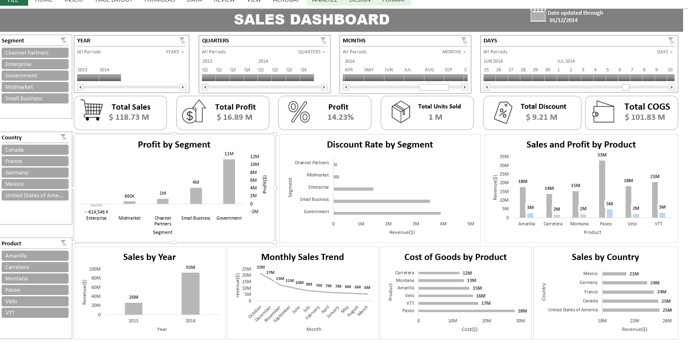
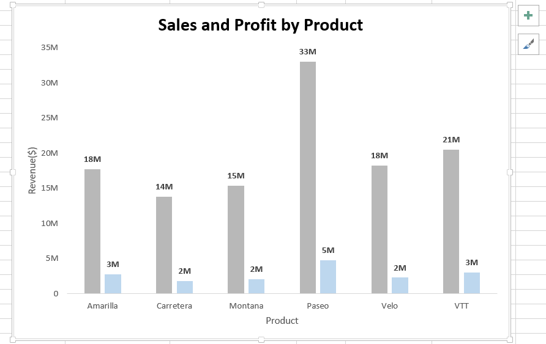
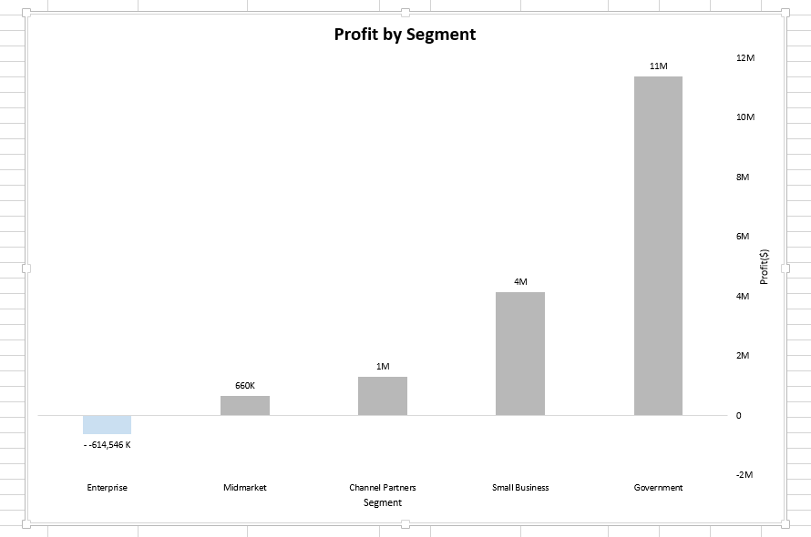
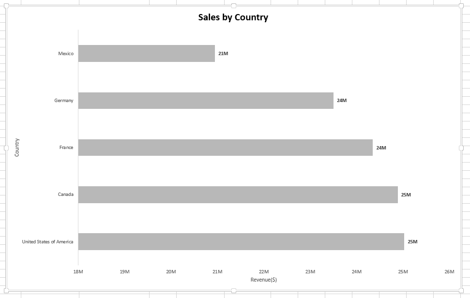
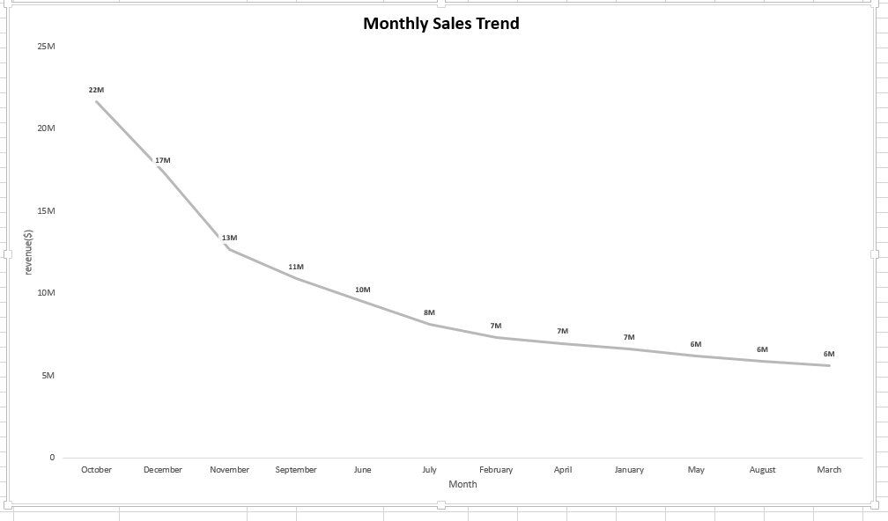

markdown
# Sales Performance Analysis (2013-2014)

## Project Overview
This project analyzes sales and profitability data from 2013 to 2014 using Microsoft Excel.

## 1. Business Problem
Explain the business questions;
- Which products generate the highest sales and profit?
- Which countries and segments contribute most to revenue?
- How do sales change over time?
- How do discounts relate to profitability?
- Where can the business improve its performance?

## 2. Data Overview
- Dataset: Financial Sample
- Period: 2013-2014
- Tools: Microsoft Excel
- Data preparation and analysis using PivotTables and PivotCharts.

## 3. Analysis results
### Dashboard Overview

### Sales and Profit by Product

### Profit by Segment

### Sales by Country

### Monthly sales Trend

### Key Findings
The analysis of the Sales Performance sample dataset (2013-2014) revealed the following insights:
1. **Overall Sales and Profitability:** The business generated total sales of $118.73 million and a total profit of $16.89 million, representing a profit margin of 14.23%. This indicates that the business was profitable during the period covered by the dataset.
2. **Sales performance by Year:** Sales increased from approximately $26 million in 2013 to $92 million in 2014. This shows that 2014 contributed a larger share of the total revenue recorded in the dataset.
3. **Product Performance:** Paseo was the highest revenue-generating product, contributing approximately $33 million in sales and $5 million in profit. VTT generated approximately $21 million in sales, while Amarilla generated approximately $18 million.
4. **Geographical Performance:** The United States and Canada recorded the highest sales, at approximately $25 million each. France and Germany followed closely at approximately $24 million each, while Mexico recorded approximately $21 million.
5. **Profitability by Segment:** Government generated the highest profit at approximately $11 million, followed by Small Business at approximately $4 million. Enterprise recorded a loss of approximately $615,000, making it the segment requiring the most attention.
6. **Cost and Discounts:** The business recorded approximately $101.83 million in Cost of Goods Sold (COGS) and $9.21 million in discounts. These figures highlight the importance of monitoring production costs and discount policies to protect profitability.
7. **Monthly Sales Trend:** The dashboard shows a declining pattern in monthly sales across the displayed period. This suggests a need to investigate the factors influencing monthly revenue changes.

### Business Recommendations
Based on the findings, the following actions are recommended:
1. **Improve Underperforming Segments:** Management should investigate the Enterprise segment's negative profit and identify whether high operating costs, pricing decisions, or discount practices are contributing to the loss. Appropriate corrective measures should be introduced.
2. **Prioritize High-performing Products:** Paseo should receive continued attention through effective marketing, product availability, and sales strategies because it contributes the highest revenue and profit among the products analyzed.
3. **Strengthen Regional Sales Strategies:** The United States and Canada should remain important markets because of their strong revenue contributions. The business should also examine opportunities to improve sales in Mexico, France and Germany.
4. **Review Pricing and Discount Policies:** Management should regularly evaluate discount practices to ensure that promotional activities support sales without unnecessarily reducing profit margins.
5. **Monitor Production Costs:** Since COGS represents a substantial proportion of total sales, the business should review production expenses, sourcing, and operational efficiency to identify opportunities for cost reduction.
6. **Investigate Monthly Sales Declines:** Management should examine the reasons behind the declining monthly sales pattern and consider targeted promotions, demand forecasting and improved sales planning.

### Dataset Limitations
Although the dataset provides useful insights into sales and profitability, some limitations should be considered:
1. **Limited Time Period:** The dataset covers only 2013 and 2014. Therefore, it may not reflect current business conditions or long-term sales patterns.
2. **Limited Customer Information:** The dataset does not provide detailed customer-level information, making it difficult to analyze customer behavior, purchasing frequency, customer retention, or lifetime value.
3. **Limited Operational Context:** Information about inventory levels, marketing expenditure, employee costs, distribution expenses, and competitor activities is not available. These factors could influence sales and profitability.
4. **Limited Explanation of Profitability:** Although the dataset contains sales, discounts, costs, and profit figures, it does not provide enough operational detail to establish the exact reasons behind losses or changes in profitability.
5. **Sample Dataset:** The Financial Sample dataset is designed for analytical practice and demonstration. its results should not automatically be treated as representative of an actual company's performnce.

### Future Analysis
Further analysis could provide deeper insights and address some of the limitations indentified:
1. **Customer Segmentation Analysis:** Analyze customer purchasing behavior and identify valuable customer groups if customer-level data becomes available.
2. **Time Series Analysis and forecasting:** Use additional years of sales data to identify seasonal patterns, forecast future revenue, and support business planning.
3. **Profitability Analysis:** Investigate the relationship between discounts, sales prices, production costs, and profit across products and business segments.
4. **Inventory and Operational Analysis:** Combine sales data with inventory and production records to identify stock shortages, excess inventory, and opportunities to improve operational efficiency.
5. **Marketing Performance Analysis:** Incorporate marketing expenditure and campaign data to measure the effectiveness of promotional activities and their contribution to revenue.

## Tools Used
- Microsoft Excel
- PivotTables
- PivotCharts
- Slicers and Timelines
- Interactive Dashboard

## Key Skills Demonstrated
- Data analysis
- Data summarisation
- Data visulaisation
- Dashboard development
- Business Insight generation
